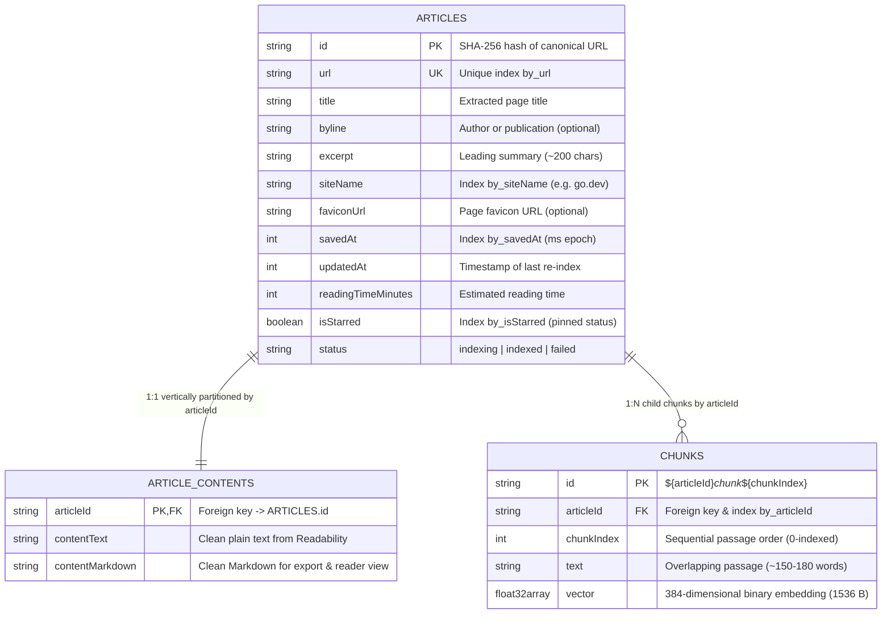
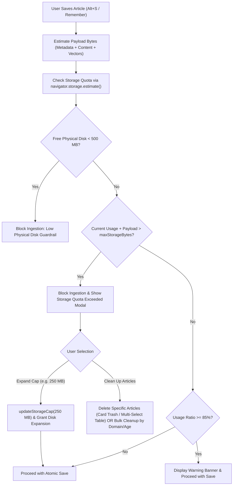

# IndexedDB Relational + Vector Storage Engine & Quota Gatekeeper

> **Module:** `src/db`  
> **Primary Interfaces:** [`src/db/schema.ts`](file:///home/prisyaga/work/chrome-rag-knowledge-base-extension/src/db/schema.ts), [`src/db/client.ts`](file:///home/prisyaga/work/chrome-rag-knowledge-base-extension/src/db/client.ts), [`src/db/repository.ts`](file:///home/prisyaga/work/chrome-rag-knowledge-base-extension/src/db/repository.ts), [`src/db/quota.ts`](file:///home/prisyaga/work/chrome-rag-knowledge-base-extension/src/db/quota.ts)  
> **Database Name:** `second_brain_db` (Version `1`)

---

## 1. Architectural Overview & Design Philosophy

`chrome-rag-knowledge-base-extension` is built on a **100% local-first, privacy-preserving storage model**. Unlike traditional cloud-backed AI assistants that send web page captures to remote vector databases (e.g., Pinecone, Qdrant, Milvus) and relational servers (PostgreSQL), this extension unifies both **Relational Metadata Management** and **High-Dimensional Vector Embeddings** inside a single, standard browser database: **IndexedDB (`idb`)**.

### Why Unified IndexedDB?

1. **Zero External Infrastructure & 100% Offline Availability:** All user captures, parsed articles, and neural vector embeddings reside on the user's local disk inside their Chrome browser profile.
2. **ACID Multi-Store Transactions:** IndexedDB natively supports atomic transactions across multiple object stores (`db.transaction(['articles', 'article_contents', 'chunks'], 'readwrite')`), enabling deterministic cascading deletes and updates without distributed transaction coordinators.
3. **Structured Clone Binary Persistence:** IndexedDB can serialize and persist native JavaScript typed arrays (`Float32Array(384)`) as raw binary blobs (1,536 bytes per chunk) without string serialization (e.g., JSON encoding/decoding) overhead.
4. **Third Normal Form (3NF) & Vertical Partitioning:** Heavy extracted body text is partitioned away from card metadata, keeping UI feed queries instantaneous (< 5 ms) while strictly avoiding transitive update anomalies.

---

## 2. Entity-Relationship Diagram (3NF Schema)



---

## 3. Relational Storage Layer Deep Dive

The relational component organizes data into three distinct object stores adhering to **Third Normal Form (3NF)** and strict data integrity rules.

### 3.1 Object Store 1: `articles` (Lightweight Metadata)

- **Primary Key:** `id` (`string`, SHA-256 hash of canonical page URL).
- **Secondary Indexes:**
  - `by_url` (`url`, `{ unique: true }`): Guarantees canonical URL uniqueness; powers instant deduplication during page navigation and saving.
  - `by_siteName` (`siteName`, `{ unique: false }`): Powers domain filtering and aggregated domain counts in the Side Panel and Knowledge Manager.
  - `by_savedAt` (`savedAt`, `{ unique: false }`): Powers reverse-chronological reading feeds via descending cursor traversal (`index.openCursor(null, 'prev')`).
  - `by_isStarred` (`isStarred`, `{ unique: false }`): Index registered for starred filtering.
- **Average Record Size:** ~400–600 bytes.
- **Performance Rationale:** Because full body text and vectors are partitioned elsewhere, loading 1,000 articles for the UI feed deserializes only ~500 KB of JSON into memory, executing in `< 5 ms` with negligible memory pressure on the extension process.

### 3.2 Object Store 2: `article_contents` (1:1 Vertical Partitioning)

- **Primary Key:** `articleId` (`string`, foreign key referencing `articles.id`).
- **Fields:**
  - `contentText` (`string`): Clean extracted text from `@mozilla/readability`.
  - `contentMarkdown` (`string`): Clean Markdown converted via `turndown` with frontmatter for `.zip` exports and reader view.
- **Average Record Size:** 15–50 KB per article.
- **Architectural Rationale (ADR 2):** IndexedDB does not support SQL-style column projections (`SELECT id, title FROM articles`). If full text were stored on `ArticleRecord`, opening the Side Panel feed would deserialize tens of megabytes of raw text every time. Partitioning full text into `article_contents` ensures that heavy text is retrieved strictly on demand (e.g., during full Knowledge Base zip export or when switching to Reader View).

### 3.3 Strict 3NF & Omitting `chunkCount` (ADR 5)

Storing `chunkCount` directly on `ArticleRecord` would introduce a transitive functional dependency:
$$\text{chunkCount} = \text{COUNT}(\text{chunks WHERE articleId} = \text{article.id})$$
This violates Third Normal Form and risks update anomalies when articles are re-indexed or chunks are regenerated. Instead, `chunkCount` is queried in $O(\log N)$ time directly from the B-tree index:

```typescript
const count = await db.countFromIndex('chunks', 'by_articleId', articleId);
```

This counts matching index keys without reading or deserializing chunk record payloads.

---

## 4. Vector Storage Layer Deep Dive

### 4.1 Native `Float32Array(384)` Structured Clone Serialization

Neural embeddings generated by the embedding pipeline (`Xenova/all-MiniLM-L6-v2`) produce 384-dimensional normalized float vectors:
$$\mathbf{v} \in \mathbb{R}^{384}, \quad \|\mathbf{v}\|_2 = 1.0$$

Each vector consists of $384 \times 4\text{ bytes} = 1,536\text{ bytes}$ of IEEE 754 32-bit floating-point numbers.

- **Storage in Store 3 (`chunks`):**
  - Primary Key: `id` format: `${articleId}_chunk_${chunkIndex}` (e.g., `a1b2c3d4_chunk_0`).
  - Secondary Index: `by_articleId` (`articleId`, `{ unique: false }`).
  - Binary Vector Field: `vector: Float32Array`.

IndexedDB natively uses the **HTML Structured Clone Algorithm**, which serializes `Float32Array` directly into underlying ArrayBuffer binary blocks on disk. This avoids the 4x–6x memory and CPU overhead of JSON array serialization (`"[0.01234, -0.05432, ...]"`).

### 4.2 In-Memory Dot-Product Vector Search Mechanics

At personal knowledge base scale:

- 1,000 articles $\times$ ~10 chunks/article = 10,000 chunks.
- Total vector memory footprint = $10,000 \times 1,536\text{ bytes} \approx 15.36\text{ MB}$.

Because the vectors are pre-normalized unit vectors ($\|\mathbf{q}\|_2 = 1, \|\mathbf{c}\|_2 = 1$), Cosine Similarity simplifies to a raw vector dot product:
$$\text{CosineSimilarity}(\mathbf{q}, \mathbf{c}) = \mathbf{q} \cdot \mathbf{c} = \sum_{i=0}^{383} q_i \cdot c_i$$

A modern V8 JIT loop scans 10,000 `Float32Array(384)` vectors in **4–10 milliseconds**, completely eliminating the need for complex, heavy C++/WASM vector index libraries (such as HNSW or IVF) inside the extension runtime.

---

## 5. ACID Multi-Store Transactions & Cascading Operations

All write operations in `src/db/repository.ts` execute within explicit multi-store ACID transactions:

```typescript
const tx = db.transaction(
  ['articles', 'article_contents', 'chunks'],
  'readwrite',
);
```

### 5.1 Re-Indexing Flow (`upsertArticleWithContent`)

When a user updates an existing article:

1. The transaction checks for existing records by `id` or `by_url`.
2. Preserves the user's original `savedAt` timestamp and pinned `isStarred` state.
3. Automatically queries all existing chunk keys via `chunks.index('by_articleId').getAllKeys(article.id)` and deletes them.
4. Writes updated `ArticleRecord` with updated `updatedAt = Date.now()`.
5. Replaces full text in `article_contents`.
6. Leaves the store ready for new chunk insertion without any stale vector residue.

### 5.2 Atomic Cascading Deletion (`deleteArticles` & `bulkDeleteUnstarred`)

When an article is deleted:

1. Parent metadata is removed from `articles`.
2. Partitioned text is removed from `article_contents`.
3. All child chunks are located via `by_articleId` and deleted from `chunks`.
4. If an unexpected error occurs during any step, IndexedDB aborts the entire transaction, ensuring zero orphaned vectors or detached content records.

---

## 6. Two-Layer Storage Quota Gatekeeper (`src/db/quota.ts`)

Chrome extensions with `"unlimitedStorage"` declared can silently consume gigabytes of user disk space. To uphold the extension's privacy-first and user-control principles, storage is governed by a **Two-Layer Quota Gatekeeper**.



### 6.1 Quota Constants & Defaults

| Constant                                      | Value                        | Description                                                    |
| :-------------------------------------------- | :--------------------------- | :------------------------------------------------------------- |
| `DEFAULT_STORAGE_SETTINGS.maxStorageBytes`    | `50 * 1024 * 1024` (50 MB)   | Initial baseline storage cap (~1,000–1,500 articles).          |
| `DEFAULT_STORAGE_SETTINGS.warnThresholdRatio` | `0.85` (85%)                 | Threshold ratio for displaying non-intrusive warning banner.   |
| `LOW_PHYSICAL_DISK_BYTES`                     | `500 * 1024 * 1024` (500 MB) | Hard physical disk guardrail to protect host system stability. |
| `DEFAULT_SUGGESTED_EXPANSION_BYTES`           | `250 * 1024 * 1024` (250 MB) | Default suggested expansion target when cap is reached.        |

### 6.2 Mathematical Model for Payload Size Estimation

Before any database write or embedding generation job is initiated, `estimatePayloadBytes()` calculates the expected footprint:

$$\text{PayloadBytes} = \text{Len}_{\text{meta}} + \text{Len}_{\text{text}} + \text{Len}_{\text{md}} + N_{\text{chunks}} \times (1536 + \text{Len}_{\text{chunk\_text}} + 128) + 192$$

Where:

- $\text{Len}_{\text{meta}}$: UTF-8 encoded length of URL, title, excerpt, byline, and domain.
- $\text{Len}_{\text{text}}, \text{Len}_{\text{md}}$: UTF-8 byte lengths of raw text and clean Markdown.
- $N_{\text{chunks}}$: Number of overlapping text chunks.
- $1536$: Byte size of 384-dimensional 32-bit float vector.
- $128, 192$: Object framing and B-tree secondary index key overhead.

### 6.3 Progressive Quota Enforcement States

1. **Normal (`usageRatio < 0.85`):** Saves proceed transparently.
2. **Warning (`0.85 <= usageRatio < 1.0`):** Saves proceed normally, but a warning badge is emitted to the Side Panel encouraging preventative cleanup.
3. **Quota Exceeded (`currentUsage + payload > maxStorageBytes`):** Ingestion pauses immediately. The user is presented with two explicit choices:
   - **Expand Storage Budget:** Increase the disk allocation to a higher maximum limit (`250 MB` default or custom MB value).
   - **Clean Up Articles:** Free up space using any of three granular cleanup methods:
     1. **Specific Individual Articles:** Click the trash icon on specific cards in the Side Panel or the `[Remove]` button on the active tab banner (`deleteArticles([id])`).
     2. **Multi-Select Bulk Deletion:** Open the Full-Screen Knowledge Manager (`options.html`) and check specific articles in the table to batch delete them.
     3. **One-Click Bulk Cleanup:** Purge all unstarred articles older than 60/90 days or all unstarred articles from a specific domain (`bulkDeleteUnstarred`).
4. **Low Physical Disk Guardrail (`freePhysicalDiskBytes < 500 MB`):** Ingestion is strictly blocked regardless of the user's extension cap until space is freed on the host machine.

---

## 7. Public API Reference (`src/db/index.ts`)

```typescript
// Connection & Lifecycle
export function getDB(): Promise<IDBPDatabase<SecondBrainDB>>;
export function closeDB(): Promise<void>;
export function resetDB(): Promise<void>;

// Relational + Vector Repository CRUD
export function upsertArticleWithContent(
  article,
  content,
  status?,
): Promise<ArticleRecord>;
export function saveArticleChunks(articleId, chunks): Promise<void>;
export function markArticleFailed(articleId): Promise<void>;
export function getArticleById(articleId): Promise<ArticleRecord | undefined>;
export function getArticleByUrl(url): Promise<ArticleRecord | undefined>;
export function getArticleContent(
  articleId,
): Promise<ArticleContentRecord | undefined>;
export function getArticleChunkCount(articleId): Promise<number>;
export function getChunksByArticleId(articleId): Promise<ChunkRecord[]>;
export function getAllChunks(): Promise<ChunkRecord[]>;
export function listArticles(options?): Promise<ArticleRecord[]>;
export function getDomainCounts(): Promise<
  Array<{ siteName: string; count: number }>
>;
export function toggleArticleStar(
  articleId,
  isStarred?,
): Promise<ArticleRecord | undefined>;
export function deleteArticles(articleIds): Promise<number>;
export function bulkDeleteUnstarred(filter): Promise<number>;

// Quota Gatekeeper
export function getStorageSettings(): Promise<StorageSettings>;
export function updateStorageCap(newMaxStorageBytes): Promise<StorageSettings>;
export function estimatePayloadBytes(article, content, textChunks): number;
export function checkStorageQuota(requiredBytes?): Promise<StorageQuotaStatus>;
```
