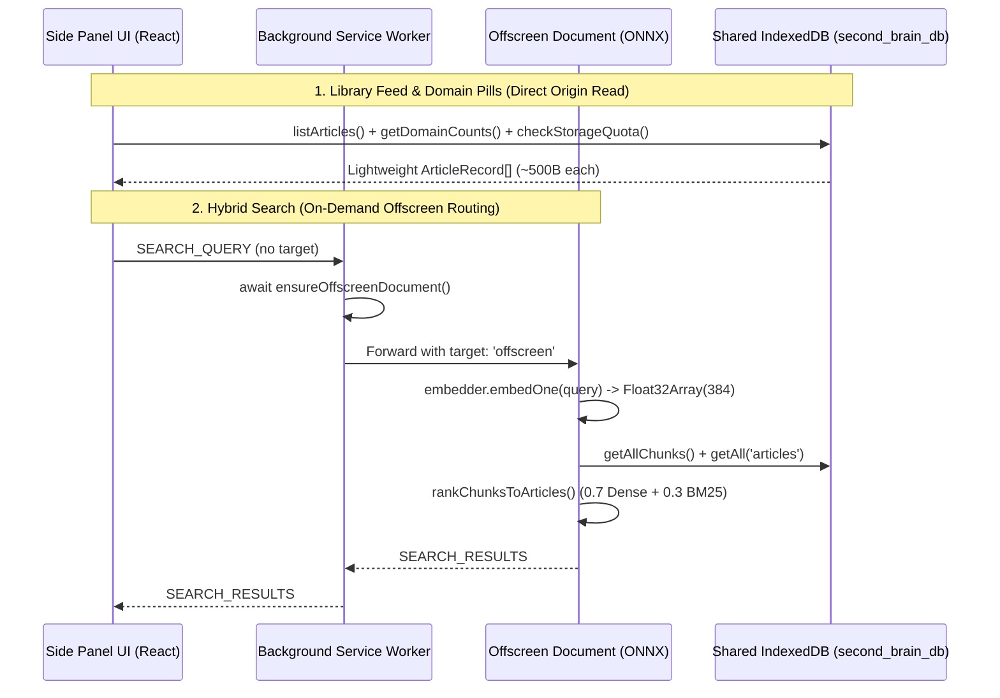

# Side Panel UI, Full-Screen Knowledge Manager & Export Architecture

> **Modules:** [`src/entrypoints/sidepanel/App.tsx`](file:///home/prisyaga/work/chrome-rag-knowledge-base-extension/src/entrypoints/sidepanel/App.tsx), [`src/entrypoints/options/App.tsx`](file:///home/prisyaga/work/chrome-rag-knowledge-base-extension/src/entrypoints/options/App.tsx), [`src/lib/export/index.ts`](file:///home/prisyaga/work/chrome-rag-knowledge-base-extension/src/lib/export/index.ts), [`src/entrypoints/background/index.ts`](file:///home/prisyaga/work/chrome-rag-knowledge-base-extension/src/entrypoints/background/index.ts)

---

## 1. Architectural Overview: Direct Shared-Origin IndexedDB + Coordinator IPC

In Chrome Manifest V3, both the **Side Panel** (`sidepanel.html`) and the **Full-Screen Knowledge Manager** (`options.html`) execute as privileged extension pages under the `chrome-extension://<id>` origin. Because they share the exact same origin as the Background Service Worker and Offscreen Document, the UI layer uses a **hybrid data access pattern**:

1. **Direct IndexedDB Reads & Mutations (`src/db`):**
   - Listing feeds (`listArticles`), computing domain filter counts (`getDomainCounts`), toggling star protection (`toggleArticleStar`), cascading deletions (`deleteArticles`, `bulkDeleteUnstarred`), and reading storage telemetry (`checkStorageQuota`, `updateStorageCap`) execute **directly against IndexedDB** from the React UI without serializing records over `chrome.runtime.sendMessage`.
2. **Background Coordinator IPC for Cross-Context Operations:**
   - **Page Ingestion (`SAVE_ACTIVE_TAB` & `Alt+S`):** Routed through the Background Service Worker's singleton `saveTab(tabId)` coordinator so that `Alt + S` (both via `chrome.commands` on web pages and in-panel keydown listeners) and the Side Panel button share the in-flight tab lock, content script auto-injection fallback, and storage quota gatekeeper. The coordinator broadcasts `SAVE_STARTED` upon commencing ingestion, `SAVE_FAILED` on early exits/errors, and `DATABASE_UPDATED` on successful article record persistence, ensuring identical loading spinners and error states across all UI contexts.
   - **On-Demand Offscreen Search Routing (`SEARCH_QUERY`, `FIND_RELATED_ARTICLES`):** Sent to the Background Service Worker without `target: 'offscreen'`. The Service Worker awaits `ensureOffscreenDocument()` before forwarding `{ ...message, target: 'offscreen' }` to the Offscreen Document AI worker. This guarantees that cold-start searches and proactive related-reading queries succeed even when Chrome has previously torn down the Offscreen Document or before any article has been saved in the current session.

---

## 2. Side Panel Companion UI (`src/entrypoints/sidepanel/`)

The Side Panel acts as an always-available reading companion synchronized with the user's active browser tab. The modernized interface uses a **cyan** primary accent palette (`cyan-700`, `cyan-800`, `cyan-600`, `cyan-50`) and a simplified, card-free layout. Business logic and UI state are decoupled into specialized custom hooks and focused presentation components:

### Custom Hooks

- **`src/hooks/useStorageQuota.ts`:** Manages `quotaStatus` (`checkStorageQuota`), `refreshQuota`, and `updateCap(newCapBytes)` (software storage budget adjustments).
- **`src/entrypoints/sidepanel/hooks/useActiveTab.ts`:** Detects active tab ID, URL, title, and queries `CHECK_TAB_STATUS`. Manages `rememberTab()`, `removeTab()`, and `updateTab()`. Subscribes to `chrome.tabs.onActivated`, `chrome.tabs.onUpdated`, `SAVE_STARTED` / `SAVE_FAILED`, `ARTICLE_INDEXED` / `STORAGE_QUOTA_EXCEEDED`, and `DATABASE_UPDATED` messages. Registers window `keydown` listener for `Alt+S` to trigger tab saving even when keyboard focus is inside the Side Panel iframe. Exposes `isSaved`, `isSaving`, `saveError`, and tab metadata.
- **`src/entrypoints/sidepanel/hooks/useSearchAndRelated.ts`:** Manages `searchQuery`, 250ms debounced search, `isSearching`, and `searchResults`. Handles `handleSnippetClick` (canonical tab matching, activating tab, focusing window via `chrome.windows.update`, or opening new tab).
- **`src/entrypoints/sidepanel/hooks/useLibraryArticles.ts`:** Manages `articles`, `domainCounts`, `filter` (`all` vs `starred`), `domainFilter`, `toggleStar`, `deleteArticle`, and `quickCleanupOldUnstarred`.

### Modular Presentation Components (`src/entrypoints/sidepanel/components/`)

- `SidePanelHeader.tsx`: Brand "Second Brain", descriptive subtitle "Semantic knowledge base in your browser", and "Full Library" launcher button without extra icons.
- `ActiveTabBanner.tsx`: Thin rounded URL copy pill with subtle hover state and conservative 2-second "Copied!" feedback badge (`bg-slate-200/80 text-slate-700`), full-width "Remember this page" primary button for unsaved tabs, "This page is saved" check indicator with reading time/indexing state, balanced equal-width "Update" (cyan) and "Delete" (conservative border) action buttons, and dismissible error banner.
- `SearchBar.tsx`: Input with search icon, clear button, and conservative slate focus ring (`focus:border-slate-400 focus:ring-slate-300/60`).
- `DomainFilterPills.tsx`: Streamlined `All`, `Starred`, and single `Domain` dropdown selector displaying `{siteName} ({count})` with conservative slate hover/selected states and active cyan pill styling.
- `ArticleCard.tsx`: Individual card in library feed (favicon, title, siteName, relative date, excerpt, reading time, star toggle, delete, subtle hover border/background, and understated title hover).
- `SearchResultCard.tsx`: Scored result card styled identically to library feed cards (favicon, title, siteName, date, article excerpt, text-only cyan `% match` indicator, subtle hover border/background, and understated title hover).
- `StorageFooter.tsx`: Quota progress bar, usage text, cyan "Export Data" button.
- `StorageQuotaModal.tsx`: Quota warning/exceeded modal (allocate custom MB vs clean up space).
- `App.tsx`: Concise, declarative orchestrator composing the hooks and components with centered dull grey middle separator positioned between header and active tab banner (~230 lines).

---

## 3. Full-Screen Knowledge Manager (`src/entrypoints/options/`)

The Options page (`options.html`) provides high-density management for larger libraries. The modernized design system shares the **cyan** primary accent palette (`cyan-700`, `cyan-800`, `cyan-600`, `cyan-50`) and conservative slate focus/hover styles introduced in the companion Side Panel:

### Custom Hook (`src/entrypoints/options/hooks/useKnowledgeManager.ts`)

- Manages table filtering (`searchQuery`, `selectedDomain`, `starredOnly`), multi-selection `selectedIds` (`toggleSelectRow`, `toggleSelectAllVisible`, `clearSelection`), `deleteSelectedArticles`, and `deleteArticlesByIds`.
- Manages bulk unstarred cleanup drawer state and execution (`handleBulkCleanup`).
- Manages `.zip` and `.json` export progress (`handleExportZip`, `handleExportJson`).
- Manages Markdown preview modal lifecycle (`previewArticle`, `previewContent`, `isPreviewLoading`, `openPreview`, `closePreview`).

### Modular Presentation Components (`src/entrypoints/options/components/`)

- `OptionsHeader.tsx`: Title ("Second Brain — Full Library"), descriptive subtitle ("Semantic knowledge base in your browser, storage budget, and exports") matching the Side Panel typography without the legacy purple icon container, and 1-click Markdown (`.zip`) and JSON export buttons with cyan icons (`text-cyan-700`).
- `StorageOverviewCard.tsx`: Cyan storage progress bar (`bg-cyan-700`), cyan `HardDrive` icon container (`bg-cyan-50 text-cyan-700`), article & vector chunk count, physical disk guardrail warning, quick cap presets (`50 MB`–`1 GB`) with cyan active state (`bg-cyan-700 text-white hover:bg-cyan-800`), custom MB cap input with conservative slate focus ring (`focus:border-slate-400 focus:ring-1 focus:ring-slate-300/60`), cyan Save Cap button (`bg-cyan-700 hover:bg-cyan-800`), and cyan model cache indicator dot (`bg-cyan-600`).
- `BulkCleanupDrawer.tsx`: Age & domain filter selectors, protected starred articles notice, and cleanup trigger button.
- `ArticlesTable.tsx`: Table layout, search and domain filter inputs with conservative slate focus rings (`focus:border-slate-400 focus:ring-1 focus:ring-slate-300/60`), cyan master checkbox (`text-cyan-700 focus:ring-cyan-600`), "Delete Selected" button, table header, rows, and empty state.
- `ArticleTableRow.tsx`: Individual row in the table with cyan row checkbox, subtle cyan selected background (`bg-cyan-50/30`), article title with conservative hover (`hover:text-slate-900`), Markdown preview button with conservative hover (`hover:bg-slate-100 hover:text-slate-800`), URL, domain, date, reading time, status, star toggle, external link, and delete action.
- `MarkdownPreviewModal.tsx`: Reads `getArticleContent(articleId)` on demand and renders clean Markdown preview in a modal dialog with conservative slate hover buttons for 1-click clipboard copy and close actions.
- `App.tsx`: Clean orchestrator composing `useStorageQuota` and `useKnowledgeManager` with dismissible cyan notification banner (`border-cyan-200 bg-cyan-50/70 text-cyan-900`) (~130 lines).

---

## 4. Client-Side Archive & Export Engine (`src/lib/export/index.ts`)

To guarantee **zero cloud lock-in and complete data ownership**, users can export their entire knowledge base at any time in two formats:

1. **Markdown Archive (`.zip` via `fflate`):**
   - `formatArticleMarkdownWithFrontmatter()` serializes each article's metadata (`title`, `url`, `siteName`, `byline`, ISO `savedAt`/`updatedAt`, `readingTimeMinutes`, `isStarred`) into YAML frontmatter prepended to `contentMarkdown`.
   - `sanitizeExportFilename()` normalizes the title into a clean ASCII slug suffixed with an 8-character hash prefix (`${slug}-${id.slice(0, 8)}.md`) so duplicate titles never collide inside the archive.
   - `buildMarkdownZipArchive()` encodes each file into UTF-8 bytes (`strToU8`), attaches an `index.json` manifest, and compresses the archive synchronously in memory via `fflate`'s `zipSync` (`level: 6`).
2. **Structured JSON Backup (`.json`):**
   - `buildJsonExportPayload()` combines `ArticleRecord`, `ArticleContentRecord`, and 3NF `chunkCount` into a formatted JSON document suitable for external tooling or backup restoration.
