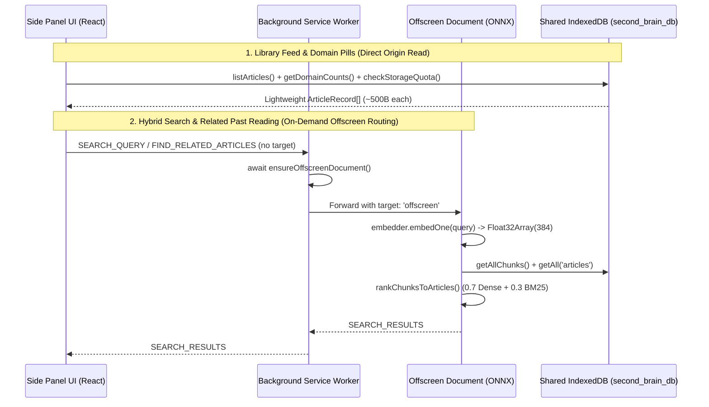

# Side Panel UI, Full-Screen Knowledge Manager & Export Architecture

> **Modules:** [`src/entrypoints/sidepanel/App.tsx`](file:///home/prisyaga/work/chrome-rag-knowledge-base-extension/src/entrypoints/sidepanel/App.tsx), [`src/entrypoints/options/App.tsx`](file:///home/prisyaga/work/chrome-rag-knowledge-base-extension/src/entrypoints/options/App.tsx), [`src/lib/export/index.ts`](file:///home/prisyaga/work/chrome-rag-knowledge-base-extension/src/lib/export/index.ts), [`src/entrypoints/background/index.ts`](file:///home/prisyaga/work/chrome-rag-knowledge-base-extension/src/entrypoints/background/index.ts)

---

## 1. Architectural Overview: Direct Shared-Origin IndexedDB + Coordinator IPC

In Chrome Manifest V3, both the **Side Panel** (`sidepanel.html`) and the **Full-Screen Knowledge Manager** (`options.html`) execute as privileged extension pages under the `chrome-extension://<id>` origin. Because they share the exact same origin as the Background Service Worker and Offscreen Document, the UI layer uses a **hybrid data access pattern**:

1. **Direct IndexedDB Reads & Mutations (`src/db`):**
   - Listing feeds (`listArticles`), computing domain filter counts (`getDomainCounts`), toggling star protection (`toggleArticleStar`), cascading deletions (`deleteArticles`, `bulkDeleteUnstarred`), and reading storage telemetry (`checkStorageQuota`, `updateStorageCap`) execute **directly against IndexedDB** from the React UI without serializing records over `chrome.runtime.sendMessage`.
2. **Background Coordinator IPC for Cross-Context Operations:**
   - **Page Ingestion (`SAVE_ACTIVE_TAB`):** Routed through the Background Service Worker's singleton `saveTab(tabId)` coordinator so that `Alt + S` and the Side Panel button share the in-flight tab lock, content script auto-injection fallback, and storage quota gatekeeper.
   - **On-Demand Offscreen Search Routing (`SEARCH_QUERY`, `FIND_RELATED_ARTICLES`):** Sent to the Background Service Worker without `target: 'offscreen'`. The Service Worker awaits `ensureOffscreenDocument()` before forwarding `{ ...message, target: 'offscreen' }` to the Offscreen Document AI worker. This guarantees that cold-start searches and proactive related-reading queries succeed even when Chrome has previously torn down the Offscreen Document or before any article has been saved in the current session.

---

## 2. Side Panel Companion UI (`src/entrypoints/sidepanel/App.tsx`)

The Side Panel acts as an always-available reading companion synchronized with the user's active browser tab:

- **Contextual Active Tab Banner:**
  - Listens to `chrome.tabs.onActivated`, `chrome.tabs.onUpdated`, and `ARTICLE_INDEXED`.
  - Queries `CHECK_TAB_STATUS` (canonicalized URL lookup against the unique `by_url` index).
  - **Unsaved State:** Displays a 1-click **`[Remember Alt+S]`** CTA and surfaces structured extraction guardrail errors (`BLOCKED_URL`, `NOT_READABLE`, `TOO_SHORT`, `incognito_blocked`).
  - **Saved State:** Displays a green indicator, save date, reading time, **`[Update]`** button (atomic re-extraction preserving `savedAt` and `isStarred`), and **`[Remove]`** button (cascading delete + badge clear).
- **Proactive "Related Past Reading" Strip:**
  - Automatically dispatches `FIND_RELATED_ARTICLES` using the active tab's title (excluding the current tab's `articleId`) and displays up to 3 semantically related articles from the user's local library.
- **Debounced Hybrid Search vs. Library Feed:**
  - Input is debounced at `250 ms`. When empty, renders the reverse-chronological Library Feed with `All`, `Starred`, and dynamic `siteName (count)` filter pills.
  - When a query is active, switches to scored passage snippets (`bestSnippet`) with relevance badges (`% match`). Clicking a result focuses or opens the target tab and dispatches `SCROLL_AND_HIGHLIGHT` to the Content Script.
- **Storage Quota Gatekeeper Modal:**
  - Opens automatically upon receiving `STORAGE_QUOTA_EXCEEDED` (or manually from the footer quota bar).
  - **Path 1 (Allocate Disk Space):** Lets the user set a custom MB limit (defaulting to `250 MB`), requests Chrome's optional `unlimitedStorage` permission when expanding above `50 MB`, updates `StorageSettings.maxStorageBytes`, and automatically retries a blocked save. Strictly disabled when `isLowPhysicalDisk` (`< 500 MB` free on host drive).
  - **Path 2 (Clean Up Space):** Offers a 1-click shortcut to purge unstarred articles older than 30 days (`bulkDeleteUnstarred`) or open the Full-Screen Knowledge Manager.

---

## 3. Full-Screen Knowledge Manager (`src/entrypoints/options/App.tsx`)

The Options page (`options.html`) provides high-density management for larger libraries:

- **3NF On-Demand Content Loading:**
  - The main table loads only `ArticleRecord` metadata from the `articles` store so rendering hundreds of rows remains instantaneous.
  - Full distilled Markdown (`ArticleContentRecord`) is fetched from `article_contents` **strictly on demand** when the user clicks **"Read Distilled Markdown"** (preview modal) or triggers a full archive export.
  - Per-article chunk counts for JSON backups are queried via the `by_articleId` B-tree index (`getArticleChunkCount`) in $O(\log N)$ time without deserializing vector chunks.
- **Multi-Select & Bulk Unstarred Cleanup:**
  - Supports multi-row checkbox selection for targeted batch deletion (`deleteArticles`) alongside a Bulk Cleanup drawer filtering by age (`All ages`, `> 7d`, `> 30d`, `> 90d`) and domain while strictly protecting starred articles (`isStarred === true`).

---

## 4. Client-Side Archive & Export Engine (`src/lib/export/index.ts`)

To guarantee **zero cloud lock-in and complete data ownership**, users can export their entire knowledge base at any time in two formats:

1. **Markdown Archive (`.zip` via `fflate`):**
   - `formatArticleMarkdownWithFrontmatter()` serializes each article's metadata (`title`, `url`, `siteName`, `byline`, ISO `savedAt`/`updatedAt`, `readingTimeMinutes`, `isStarred`) into YAML frontmatter prepended to `contentMarkdown`.
   - `sanitizeExportFilename()` normalizes the title into a clean ASCII slug suffixed with an 8-character hash prefix (`${slug}-${id.slice(0, 8)}.md`) so duplicate titles never collide inside the archive.
   - `buildMarkdownZipArchive()` encodes each file into UTF-8 bytes (`strToU8`), attaches an `index.json` manifest, and compresses the archive synchronously in memory via `fflate`'s `zipSync` (`level: 6`).
2. **Structured JSON Backup (`.json`):**
   - `buildJsonExportPayload()` combines `ArticleRecord`, `ArticleContentRecord`, and 3NF `chunkCount` into a formatted JSON document suitable for external tooling or backup restoration.
